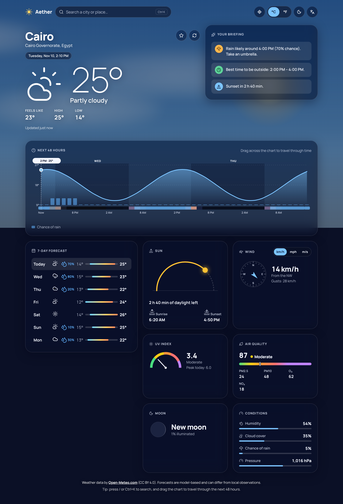
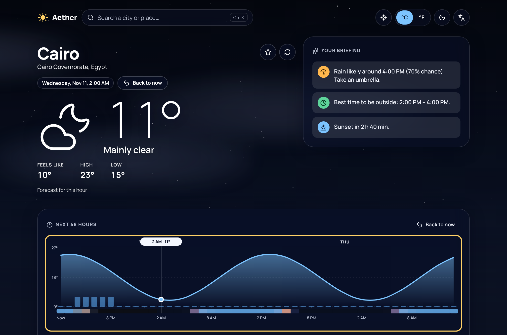
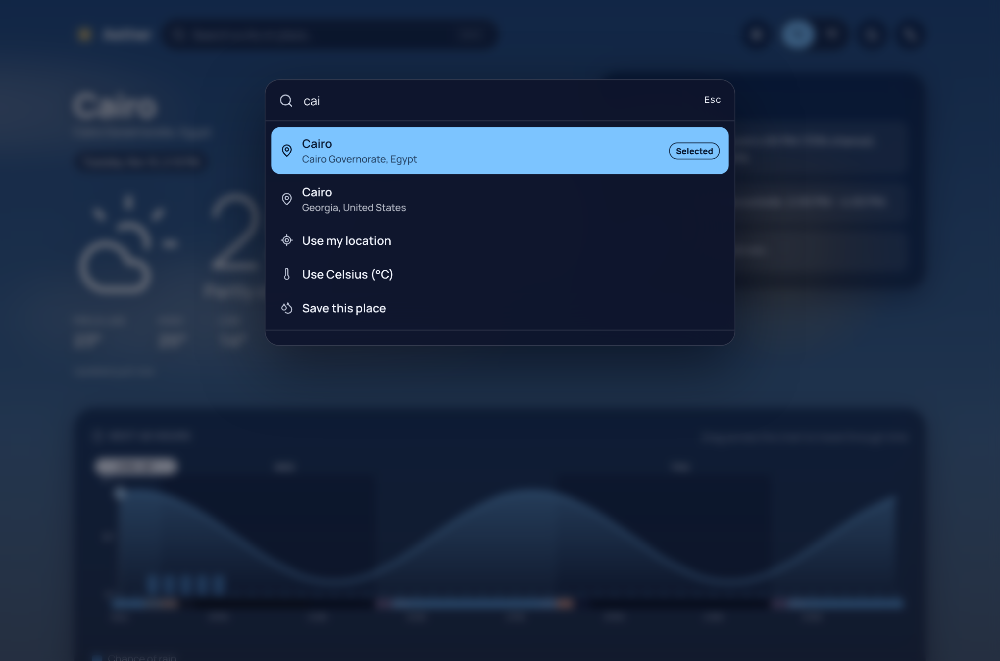
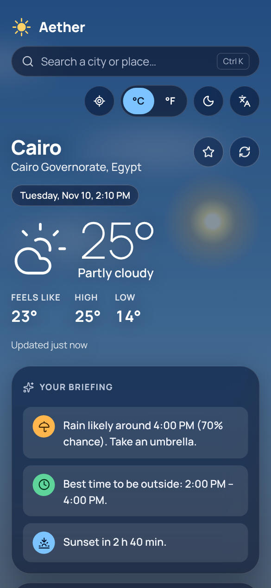
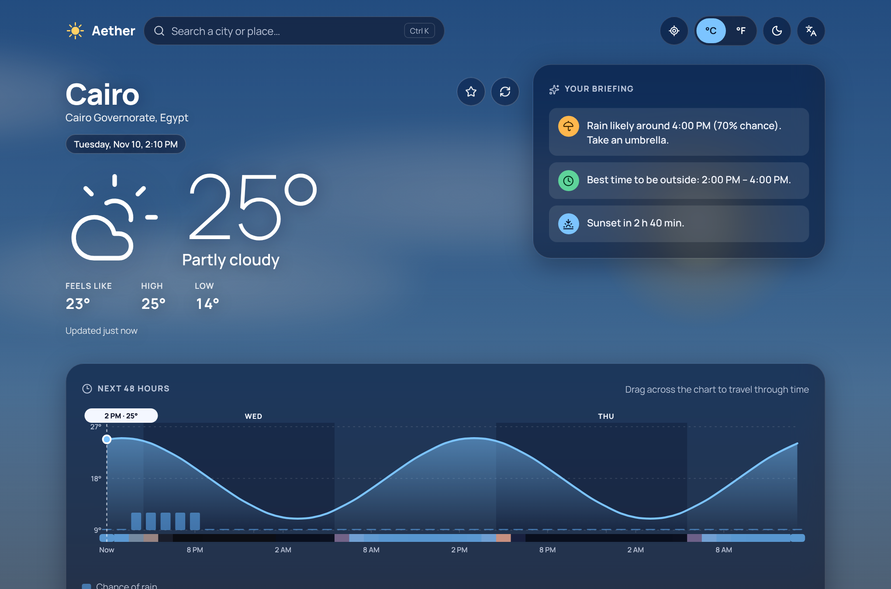

# Aether

> The weather, as a living sky.

Aether turns the forecast into a sky you can read at a glance. Its colours follow the **real position of the Sun** for each place and time,
modified by current weather. Drag across the 48-hour chart and the whole sky travels with you.



| Time travel                                      | Command palette                                  |
| ------------------------------------------------ | ------------------------------------------------ |
|  |  |

| Mobile                                                             | Arabic · RTL · light                         |
| ------------------------------------------------------------------ | -------------------------------------------- |
|  |  |

## Features

- **Live sky:** NOAA solar position, golden hour and twilight, stars, Sun and Moon (with phase), drifting clouds, fog, canvas rain/snow,
  lightning.
- **Time travel:** drag or use the keyboard (←/→, PageUp/PageDown, Home/End, Esc) on the 48-hour chart.
- **Briefing:** rule-based insights (rain soon, heat, UV peak, air quality, best window outside, sunset…).
- **Command palette:** `Ctrl/⌘ + K` or `/` to search places and run commands.
- **Details:** 7-day forecast, sun arc, wind compass, UV gauge, air quality, moon phase, humidity/cloud/pressure.
- **Preferences:** °C/°F, km/h · mph · m/s, light/dark/system, English/العربية (RTL), saved places, geolocation (opt-in).
- **Resilient:** stale-while-revalidate forecast cache, offline app shell, offline banner, retry with backoff, and installable PWA.
- **Installable app:** Android/Chromium install prompt, iOS Add to Home Screen instructions, standalone display mode, safe-area layouts,
  branded app icons, and platform launch artwork.
- **Launch experience:** a short animated Aether intro on cold launches of the installed standalone app (not on ordinary browser visits), with reduced-motion support. iOS startup artwork is supplied separately through Apple startup-image links.
- **Weather alerts:** optional browser notifications for severe conditions while Aether is open. Background push needs a Web Push server.

## Run it

```bash
npm ci
npm run dev        # http://localhost:5173
npm run check      # format, lint, typecheck, unit tests, build
npm run e2e        # Playwright (mocked network)

# Test the installed PWA (production service worker + manifest)
npm run build && npm run preview  # http://localhost:4173
```

Node 22.22.2+ (`.nvmrc`). First e2e run: `npx playwright install chromium`.

**Install the PWA:** use `npm run build && npm run preview` (or deploy over HTTPS). The service worker is intentionally disabled in
`vite dev` so it does not interfere with hot-module replacement; the browser's native install prompt is therefore only testable in Preview
or production. On iPhone/iPad, open the Share menu and choose **Add to Home Screen**.
Deploying under a sub-path: `BASE_PATH=/aether/ npm run build`.

## Stack

Vite 7 · React 19 + React Compiler · TypeScript strict · Zod 4 · Vitest · Playwright + axe · vite-plugin-pwa · self-hosted fonts
(Manrope, Noto Sans Arabic).

## Structure

```
src/
  core/      pure logic: solar, moon, sky, particles, insights, spline, units, format
  data/      HTTP, Zod schemas, Open-Meteo adapter, cache
  state/     versioned persisted store
  hooks/     forecast (SWR), online, clock, geolocation, hotkeys
  i18n/      typed EN/AR dictionaries
  features/  sky · forecast · search
  app/       shell, header, footer
tests/e2e/   Playwright specs
docs/        ARCHITECTURE, REFACTOR, ADRs, screenshots
```

See [docs/ARCHITECTURE.md](docs/ARCHITECTURE.md), [docs/REFACTOR.md](docs/REFACTOR.md), [docs/PWA.md](docs/PWA.md) and [docs/adr](docs/adr).

## Honest limitations

- Aether is a Progressive Web App, not a native Android/iOS binary. It can be installed and launched in standalone mode, but browser and
  operating-system APIs determine which capabilities are available.
- Geolocation is requested only after the user taps **Use my location**. Notifications are optional and requested only when the user enables
  weather alerts. Camera, microphone, contacts, and unrelated permissions are not requested; the dashboard does not need them.
- Severe-weather notifications are evaluated while the app is open. Background delivery needs a server-side Web Push sender, VAPID keys, and
  subscription storage, which are not included in this frontend-only repository.
- The Moon's on-screen position is stylised; the sky is an artistic model driven by real geometry, not a camera or an ephemeris.
- Forecasts are model output and can differ from local observations.
- Data comes from [Open-Meteo](https://open-meteo.com/) (CC BY 4.0; the free API is for non-commercial use).
- The bundled e2e tests and screenshots use mocked responses; they never call the live API.
