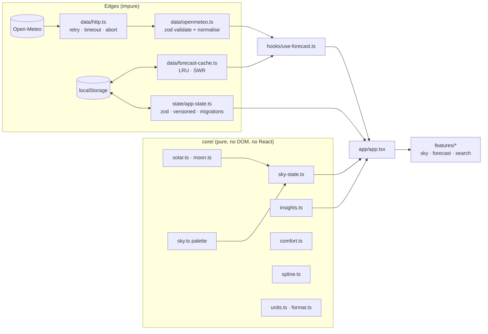

# Architecture

Aether is a client-only SPA. The guiding rule: **pure logic at the centre, I/O and React at the edges.**

## Layers

| Layer       | Responsibility                                                                            | Rules                                     |
| ----------- | ----------------------------------------------------------------------------------------- | ----------------------------------------- |
| `core/`     | Solar geometry, sky colour, particles, insights, comfort score, spline, units, formatting | No imports from React, DOM or `data/`     |
| `data/`     | HTTP, schema validation, normalisation to the domain model, cache                         | Raw API shapes never leave this folder    |
| `state/`    | Persisted preferences (units, theme, language, places)                                    | Pure transitions; storage is validated    |
| `hooks/`    | Bridges to the outside world (forecast SWR, online, clock, geolocation, hotkeys)          |                                           |
| `i18n/`     | Typed EN/AR dictionaries, interpolation, direction                                        | Missing keys fail `tsc`; parity is tested |
| `features/` | UI grouped by feature                                                                     | Components render; logic lives in `core/` |
| `app/`      | Shell: wires state, forecast, sky, palette                                                |                                           |

## The sky

`computeSky(lat, lon, time, weather)` is a pure function: NOAA solar position → elevation keyframes interpolated with smoothstep → weather modifiers (grey, darken, fog, cloud, particles). The result is written to CSS custom properties (`--sky-top`, `--sun-x`, …). Colours transition via registered `@property <color>`, so React never animates anything per frame. Rain and snow are a typed-array particle system drawn on one canvas.

**Time travel:** the scrubber on the 48-hour chart supplies a different `time` and `weather` to the same function, so the sky, hero and readouts all move together.

## Data flow and caching

1. The API is always asked for metric units. Conversion to °F / mph / m/s happens client-side, so toggling units never refetches and the cache is unit-agnostic.
2. `useForecast` reads the cache first: fresh (< 10 min) → no request; stale (< 6 h) → show immediately and revalidate; none → loading.
3. A failed refresh never blanks the screen: the last forecast stays with an explanatory banner.
4. Air quality is optional (`allSettled`); its failure only hides that card.

## Testing strategy

- **Unit (vitest, ~105 tests):** solar/moon accuracy, sky continuity and WCAG contrast, spline monotonicity, insights, formatting, HTTP retry, schema/normalisation, cache expiry, state migration, i18n parity.
- **E2E (Playwright, network mocked, clock frozen):** rendering, time travel by keyboard and drag, unit toggles without refetch, command palette, persistence, Arabic/RTL, error/stale/offline states, axe scans in both themes, mobile overflow.
